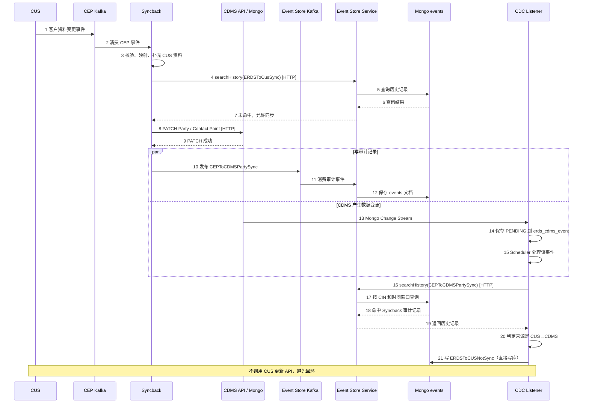

# CDMS 服务 OpenTelemetry Trace Demo 分析

> 范围：5 个服务（均以 OTel Java Agent 自动接入），目标是在 Grafana Tempo 中展示跨服务 trace（服务A → 服务B → MongoDB）。
> 说明：本文基于 Copilot 的扫描结论与业务时序图做分析，**未直接核对源码**，引用的类名 / 行号以 Copilot 扫描结果为准。

## 0. 服务与时序图对照

| 仓库 | 时序图中的角色 |
|---|---|
| `cdms-syncback-service-cep` | Syncback |
| `cdms-event-store-service` | Event Store Service |
| `cdms-cdc-listener-service` | CDC Listener |
| `cdms-gl-gbl-sor-cpmg-party` | CDMS API（Party） |
| `cdms-gl-gbl-sor-cpmg-contact-point` | CDMS API（Contact Point） |

业务时序（编号对应原图步骤）：



---

## 1. Copilot 的分析评估：大方向正确，有遗漏

### 1.1 正确的部分

| 观点 | 评价 |
|---|---|
| 是不是同一个 trace ID，取决于 trace context 有没有传播，与入口是否为 HTTP 无关 | ✅ 正确。Kafka 消费 span、定时任务 span 都可以作为 trace 根 |
| Correlation-Id 相同不代表是同一条 trace | ✅ 正确。业务 ID 与 `traceparent` 是两套体系 |
| MongoDB 不需要部署 Agent，会显示为调用方服务下的数据库 client span | ✅ 正确 |
| Change Stream 不会携带原始写请求的 `traceparent` | ✅ 正确 |
| 批量消费会变成 span link 而非父子关系 | ✅ 正确。Java Agent 对 batch listener 生成 batch process span，通过 link 关联各条消息，trace ID 不同 |
| 网关 / 代理可能丢弃 `traceparent`；采样需一致 | ✅ 正确。建议各服务统一使用 `parentbased_*` 采样器 |

### 1.2 偏保守的地方

- **CompletableFuture**：Java Agent 默认会在 `Executor`、`ForkJoinPool`、`CompletableFuture.*Async` 之间传播 context，一般不会断。真正容易断的是：
  - 自己 `new Thread()`
  - 通过内存队列（如 `BlockingQueue`）把任务交给其他线程处理
  - batch listener

### 1.3 遗漏的两点

1. **Syncback 这一段可以串成一条 trace，且涉及的服务比 Party refresh 更多。** Copilot 只提到第 4 步 searchHistory 走 HTTP，遗漏了：
   - 第 8 步：Syncback 通过 HTTP PATCH 调用 Party / Contact Point，再落到 Mongo。
   - 第 10–12 步：Syncback 发消息到 Event Store Kafka，Event Store 消费后写 Mongo events。Java Agent 会自动把 `traceparent` 写入 Kafka header。只要 Event Store 是**逐条消费**（非 batch），这段默认就是父子关系，trace ID 不变。
2. **CDC Listener 内部还有第二个断点。** 第 13 → 14 → 15 步是：Change Stream 收到变更 → 存 PENDING 到 `erds_cdms_event` → **Scheduler 稍后再捞出来处理**。数据落库后再被定时任务取出，context 必然丢失。即使 Change Stream 能带上 trace，到 Scheduler 也会重新开始一条新 trace。

---

## 2. 按时序图划分 trace 边界

```
━━━━━━━━━━━━ Trace A：一条 CEP 消息触发 ━━━━━━━━━━━━
CEP Kafka ──(Kafka header 自动传播)──▶ Syncback [consumer span，trace 起点]
   ├─ ④ HTTP searchHistory ──▶ Event Store ──⑤ find ──▶ Mongo events
   ├─ ⑧ HTTP PATCH ──────────▶ Party / Contact Point ──▶ Mongo
   └─ ⑩ Kafka produce ───────▶ Event Store [consumer] ──⑫ insert ──▶ Mongo events
                                  （逐条消费时同一 trace；batch 消费时仅为 link）

         ✂ 断点 1：⑬ Mongo Change Stream（不携带 traceparent）
         ✂ 断点 2：⑭ 存 PENDING → ⑮ Scheduler 异步捞取

━━━━━━━━━━━━ Trace B：CDC Scheduler 触发 ━━━━━━━━━━━━
CDC Listener [scheduled span，trace 起点]
   ├─ ⑯ HTTP searchHistory ──▶ Event Store ──⑰ find ──▶ Mongo events
   └─ ㉑ 直接 insert ERDSToCUSNotSync ──▶ Mongo（直接写库，不经过 Event Store）
```

结论：整张时序图在 Tempo 中**至少是两条 trace**，A 与 B 之间默认串不起来。若 Event Store 审计消费是 batch 模式，Trace A 还会再拆出一条。

---

## 3. Demo 方案对比

| 方案 | 链路 | 涉及服务 | 触发难度 | 定位 |
|---|---|---|---|---|
| **1. Party refresh**（Copilot 推荐） | Party → Contact Point → Mongo | 2 | 低：Postman 发一个 POST，但需挑选满足条件的客户 | **先跑通，验证环境** |
| **2. 发一条 CEP 消息** | Syncback → Event Store / Party / Kafka → Event Store → Mongo | 3–4 | 中：需能向测试环境的 CEP topic 发消息 | **正式演示，效果最好** |
| 3. CDC 链路 | CDC → Event Store → Mongo | 2 | 不可控：依赖数据变更与 Scheduler 周期 | 补充 |
| 4. 端到端串联 A 与 B | 全链路 | 全部 | 需改代码 | 进阶 |

建议：先用方案 1 确认传播、采样和代理配置都正常，再用方案 2 正式演示。方案 2 中若发消息的工具未做 instrumentation（如 `kafka-console-producer`），Syncback 的 consumer span 会成为根节点，不影响展示。

### 3.1 方案 1 要点（来自 Copilot 扫描结论）

- 入口：`POST /api/v1/parties/{partyIdentifier}/refresh`
- 调用过程：Party 查询 Mongo party → 重新计算验证状态 → `ContactPointClient.hasEmailOrMobilePhone` 调用 Contact Point `GET /api/v1/contact-points`（`blockOptional()` 同步等待）→ Contact Point 读取 MongoDB
- 测试客户需满足：个人客户；有有效的完整姓名和生日；`partyFormalIdentifiers` 为空（证件信息不能让验证逻辑提前返回）；Contact Point 中有该客户的联系资料
- 确认 Party 的 `CDMS-CONTACT-POINT-SOR-URI` 指向已接入 OTel 的 Contact Point 实例
- refresh 可能会更新验证状态，务必使用测试环境和测试客户

### 3.2 方案 4 思路（把 CDC 也串进来）

1. CDMS 写 Mongo 时，把当前 `traceparent` 一并存入文档的某个字段。
2. CDC 从 Change Stream 的 fullDocument 中取出该值，随 PENDING 记录一起保存。
3. Scheduler 处理该记录时，用这个值创建 **span link**（推荐）或作为 parent。

使用 span link 时，Grafana 中可一键跳转到上游 trace。时序图中第 17–18 步用“CIN + 时间窗口”判断来源，本质上也是在做这种关联。

---

## 4. 重点链路：Syncback → Party / Contact Point → MongoDB

### 4.1 什么是“Kafka header 自动传播”

HTTP 调用时，trace 上下文放在请求头 `traceparent` 里传给下游。Kafka 消息也有 header，作用相同。Java Agent 自动处理两端：

```
生产者（已装 Agent）                          消费者（已装 Agent）
producer.send(record)                         @KafkaListener / poll()
  │ Agent 自动在 record.headers 中写入：         │ Agent 自动从 headers 读取 traceparent
  │ traceparent: 00-<traceId>-<spanId>-01      │ 以其为父节点创建 consumer span
  ▼                                            ▼
═════════════════ Kafka Topic ═════════════════▶ 两边 trace ID 相同
```

“自动传播”即**双方都装了 Agent**，无需写任何代码，trace 就能穿过 Kafka 连起来。

### 4.2 Syncback 消费 CEP Kafka 时是否有 trace 上下文

**有**，Java Agent 会自动创建。但 trace 很可能**从 Syncback 开始**，因为 CEP 消息的发送方 CUS 大概率不在本 OTel 体系内。具体取决于 CUS 是否写入 `traceparent` header：

| 情况 | 结果 |
|---|---|
| **CUS 未接 OTel**（最可能） | 消息无 traceparent。Syncback 的 Agent **新建一个 trace**，consumer span 为根节点，后续调用都挂在其下。**完全满足追踪需求** |
| CUS 接了 OTel，但上报到其他后端 | Syncback 沿用 CUS 的 trace ID，但 Tempo 中没有父 span，Grafana 提示 *root span not yet received*。不是错误，只是展示上缺一截 |
| CUS 接了 OTel，且上报到同一 Tempo | 可一直串到 CUS，最理想 |

判断方法：在测试环境查看一条 CEP 消息的 header：

```bash
kafka-console-consumer.sh --bootstrap-server <broker> --topic <cep-topic> \
  --property print.headers=true --max-messages 1
```

有 `traceparent` 属于后两种情况，没有则属于第一种。

### 4.3 预期 trace 结构

```
<cep-topic> process            Syncback        CONSUMER  ← 根 span（Agent 自动创建）
 ├─ POST                       Syncback        CLIENT    （searchHistory 调用）
 │   └─ POST /...              Event Store     SERVER
 │       └─ find events        Event Store     mongodb
 └─ PATCH                      Syncback        CLIENT    ← Agent 自动在 HTTP 头写入 traceparent
     └─ PATCH /api/v1/parties/{id}  Party      SERVER    ← Agent 自动读取，成为子 span
         └─ update party       Party           mongodb   ← Mongo 驱动被 Agent 拦截
```

全部由 Agent 自动生成，**无需改代码**。

### 4.4 可能断链的情况（演示前确认）

1. **消费方式**
   - Spring Kafka `@KafkaListener` 逐条消费最稳，每条消息一个 process span。
   - 若为 **batch listener**（Copilot 提到 Syncback 有批量消费），一批消息共用一个根 span，**一条 trace 中会包含多条消息的 PATCH 调用**。链路依然完整，只是不够干净。演示时每次只发一条消息即可。
2. **线程切换**
   - listener 内使用 `CompletableFuture.*Async` 或线程池，Agent 自动传播 context，没有问题。
   - 若先把消息放入内存队列再由其他线程处理，或自行 `new Thread()`，会**断链**，PATCH 变成一条新 trace。
3. **网关 / 代理**：Syncback 调用 Party 若经过 API 网关，网关必须原样转发 `traceparent` 头。
4. **采样**：各服务采样器建议统一为 `parentbased_always_on` 或 `parentbased_traceidratio`，避免下游丢弃上游已采样的 trace。

---

## 5. 验收方法

### 5.1 日志快速验证

Agent 默认会把 `trace_id` 写入 Logback / Log4j 的 MDC：

1. 在两个服务的日志 pattern 中加入 `%X{trace_id}`。
2. 发送一条测试消息。
3. 对比 Syncback 处理日志与 Party 收到 PATCH 时日志中的 trace_id，**一致**即说明已串联。

### 5.2 Tempo TraceQL 查询

服务名以各服务实际的 `OTEL_SERVICE_NAME` 为准，以下用仓库名代替：

```
// 方案 1：Party 下游包含 Contact Point 的 Mongo 调用
{ resource.service.name = "cdms-gl-gbl-sor-cpmg-party" }
  >> { resource.service.name = "cdms-gl-gbl-sor-cpmg-contact-point" && span.db.system = "mongodb" }

// 方案 2：Syncback 下游包含 Event Store 的 Mongo 调用
{ resource.service.name = "cdms-syncback-service-cep" }
  >> { resource.service.name = "cdms-event-store-service" && span.db.system = "mongodb" }

// Syncback → Party → MongoDB
{ resource.service.name = "cdms-syncback-service-cep" && kind = consumer }
  >> { resource.service.name = "cdms-gl-gbl-sor-cpmg-party" && span.db.system = "mongodb" }
```

在 Tempo 中验收时：
- 预期在同一个 trace ID 下看到：上游服务 span、HTTP client span、下游服务 server span、MongoDB 数据库 span。
- 上游返回 200 不足以证明下游成功（客户端可能吞掉部分 HTTP 错误），需检查下游 span 的状态。
- 若需在服务拓扑图上展示 `A → B → mongodb`，需开启 Tempo metrics-generator 的 service-graphs。Mongo 会通过 `db.system` / `db.name` 等属性显示为虚拟节点。

### 5.3 注意事项

- Mongo Change Stream 的 `getMore`、Scheduler 空跑都会产生大量零散的小 trace，查询时按服务名和 span 名过滤。
- 提前确认 Event Store 的审计消费者是否为 batch listener，这决定了第 10 → 11 步在 Tempo 中是父子关系（同一 trace）还是仅有 link。
